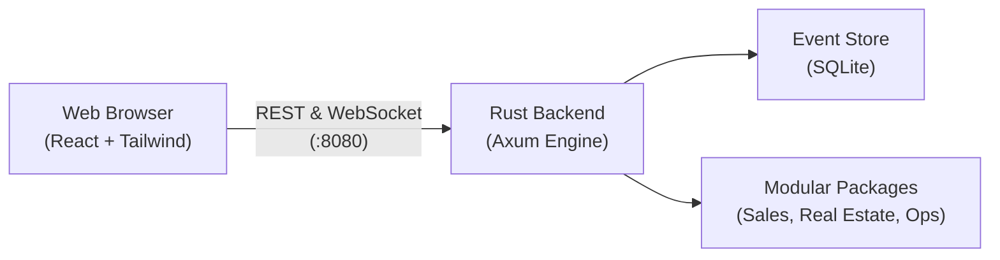

# Operating Layer

A modular, event-sourced business control plane built with Rust and React. It unifies sales leads, real estate deals, messaging, and role-based permissions into a single self-hosted system.

---

## Architecture at a Glance



* **Frontend**: React 18, TypeScript, Tailwind CSS, and TanStack Query.
* **Backend**: Rust (Axum) running asynchronous background workers.
* **Storage**: SQLite with write-ahead logging (WAL) storing an immutable event stream and live projections.
* **Package System**: Pluggable modules (`sales-core-v1`, `real-estate-v1`, `notification-package-v1`) that can be activated on demand.

---

## Quickstart

### Prerequisites
* [Rust](https://rustup.rs/) (1.75 or later)
* [Node.js](https://nodejs.org/) (18 or later) & npm

### 1. Clone the repo
```bash
git clone https://github.com/harshabk22/Operating-Layer.git
cd Operating-Layer
```

### 2. Build the frontend
```bash
cd frontend
npm install
npm run build
cd ..
```

### 3. Run the backend
```bash
cargo run
```
* On first run, it initializes the SQLite database (`business.db`), applies migrations, and hydrates installed packages.
* Open your browser and go to **`http://localhost:8080`**.

### Default Logins
| Role | Username | Password | Access Level |
| :--- | :--- | :--- | :--- |
| **Owner** | `owner` | `admin` | Full system access, packages, settings, user management |
| **Operator** | `operator` | `admin` | Leads, deals, customer inbox, daily operations |

---

## Environment Variables & APIs

The app works right out of the box with built-in defaults for local development. If you want to customize ports, credentials, or add third-party APIs, copy the sample file:

```bash
cp .env.example .env
```

### Key Configuration Options

| Variable | Default | Purpose |
| :--- | :--- | :--- |
| `PORT` | `8080` | Port the web server listens on |
| `MOAT_SECRET_KEY` | `MoatAgeexSuperSecretKey123` | Secret used to sign session cookies |
| `OWNER_PASSWORD` | `admin` | Password for the `owner` account |
| `OPERATOR_PASSWORD` | `admin` | Password for the `operator` account |
| `AGEEX_PROVIDER` | `deepseek` | LLM provider (`deepseek`, `google`, `anthropic`, `openai`) |
| `DEEPSEEK_API_KEY` | *(empty)* | Optional API key for DeepSeek |
| `GOOGLE_API_KEY` | *(empty)* | Optional API key for Google Gemini |
| `GOOGLE_CLIENT_ID` | *(empty)* | Google OAuth client ID for Calendar/Sheets |
| `GOOGLE_CLIENT_SECRET` | *(empty)* | Google OAuth client secret |
| `WHATSAPP_ENABLED` | `false` | Enable/disable WhatsApp connector |

---

## Local Development Workflow

If you are modifying both the frontend and backend with hot reload:

1. **Start the Rust server**:
   ```bash
   cargo run
   ```

2. **Start the Vite dev server** (in another terminal):
   ```bash
   cd frontend
   npm run dev
   ```
   Open `http://localhost:3000`. API requests to `/api` and WebSockets automatically proxy to `http://localhost:8080`.

---

## Running Tests

### Backend Unit & Integration Tests
```bash
cargo test --workspace
```
*(162 tests covering event projections, auth, API routes, and packages)*

### Frontend Typecheck & Lint
```bash
cd frontend
npm run lint
npm run build
```

### End-to-End Tests
Playwright tests spin up the server and verify the full UI flow across all user roles:
```bash
cd e2e
npx playwright test
```

---

## Project Structure

```
├── moat_app/        # Binary entry point, daemon bootstrap, and background workers
├── moat_core/       # Core business logic, event store, Axum API server, and auth
├── frontend/        # React operator dashboard and UI components
├── moat_admin/      # Admin portal for multi-tenant deployments
├── e2e/             # Automated Playwright test suite
├── sales-core-v1/   # Sales leads & pipeline package
├── real-estate-v1/  # Properties, offers, and deals package
└── whatsapp-v1/     # Messaging integration package
```

---

## License
MIT
